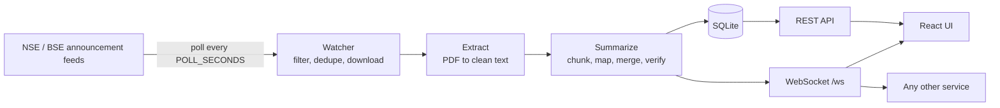

# Concall Desk

**Real-time earnings-call intelligence for Indian listed companies.**
It watches NSE/BSE for concall transcripts the moment they are filed, extracts the PDF, builds a faithful structured AI summary, and streams it to a web UI and to any other service over a WebSocket.

> Built for the Finosauras Tech Software Engineer Intern take-home assignment.

---

## Contents
- [What it does](#what-it-does)
- [Quick start](#quick-start) (including [exporting samples](#export-sample-outputs))
- [Configuration](#configuration)
- [How it works](#how-it-works)
- [Output schema](#output-schema)
- [API and WebSocket](#api-and-websocket)
- [Design decisions](#design-decisions)
- [Which companies](#which-companies) (watchlist vs all, default companies)
- [Assignment checklist](#assignment-checklist)
- [Known limitations](#known-limitations)
- [Troubleshooting](#troubleshooting)
- [Project structure](#project-structure)
- [Testing](#testing)
- [What I would do with more time](#what-i-would-do-with-more-time)

## What it does

1. **Watches** the NSE (and BSE) announcement feeds on a loop, keeps only concall *transcripts*, and downloads the PDF.
2. **Extracts** clean text: removes repeated headers/footers and page numbers, keeps speaker labels, falls back to OCR for scanned pages.
3. **Summarises** with any OpenAI-compatible LLM using chunking + map-reduce, so 40-page transcripts fit small context windows. Every key number is checked against the source text.
4. **Serves** the result through a React UI, a REST API, and a WebSocket that other apps can subscribe to.

It runs unattended: no manual trigger is needed once started.

## Quick start

**Requirements:** Python 3.10+ and Node 18+ (Node is optional if you only use `--api-only`).

```bash
git clone https://github.com/krish-maurya/Concall.git
cd Concall
# 1. one-time: add your LLM key
cp concall-pipeline/.env.example concall-pipeline/.env
# Windows: copy concall-pipeline\.env.example concall-pipeline\.env
#    then edit concall-pipeline/.env and set LLM_API_KEY=<your key>

# 2. start everything (backend + UI) from this folder
python run.py
```

`run.py` installs missing Python/npm packages on first run, starts the backend (http://localhost:8000) and the UI (http://localhost:5173), opens your browser, and stops both on **Ctrl+C**. A fresh clone can open the UI in sample-preview mode without an API key. Add `LLM_API_KEY` to enable live summarization; the project never fabricates summaries.

| Command | What it does |
|---|---|
| `python run.py` | Backend + React UI |
| `python run.py --api-only` | Backend only; a built-in page is served at http://localhost:8000 |
| `python run.py --no-browser` | Don't open the browser |

Free LLM keys work: [Groq](https://console.groq.com), Google Gemini and OpenRouter all expose OpenAI-compatible endpoints.

### Export sample outputs

Once some summaries have finished (watch them appear in the UI), export them as files. Run this from the `concall-pipeline` folder:

```bash
cd concall-pipeline
python tools/export_samples.py
```

For every stored summary it writes a folder `concall-pipeline/samples/<Company>_<Quarter>/` containing:

| File | What it is |
|---|---|
| `transcript.txt` | The raw, cleaned transcript text extracted from the PDF |
| `summary.json` | The machine-readable summary (matches the [output schema](#output-schema)) |
| `summary.md` | The human-readable Markdown summary |

The assignment asks for sample outputs for at least 3 companies. To get older calls quickly, use **Fetch older calls** in the UI (or `POST /api/backfill?days=45`), wait for the summaries to finish, then run the export and commit the `samples/` folder.

## Configuration

All settings live in `concall-pipeline/.env` (see `.env.example`). Nothing secret is committed.

| Variable | Default | Meaning |
|---|---|---|
| `LLM_API_KEY` | *(required)* | Provider API key |
| `LLM_BASE_URL` | Groq OpenAI endpoint | Any OpenAI-compatible base URL |
| `LLM_MODEL` | `openai/gpt-oss-120b` in the example | Model id (list yours: `GET {LLM_BASE_URL}/models`) |
| `WATCH_MODE` | auto | `watchlist` = only your companies, `all` = every transcript found. Auto = `watchlist` if `WATCHLIST`/`SYMBOLS` is set, else `all` |
| `WATCHLIST` | empty | Comma-separated company-name fragments, e.g. `"HDFC Bank,Tata Motors"` |
| `SYMBOLS` | empty | Optional NSE symbols, queried one by one |
| `MAX_SUMMARIES_PER_DAY` | `40` in `all` mode, `0` (unlimited) otherwise | Daily cap on new summaries, a cost safety valve |
| `POLL_SECONDS` | `120` | How often to check the exchanges |
| `LOOKBACK_DAYS` | `3` (`45` in the example) | How far back each check looks |
| `SOURCES` | `nse,bse` | Set to `nse` to skip BSE |
| `LLM_TPM` | `7000` | Token-per-minute budget the client paces itself under |
| `LLM_MAX_OUT` | `1200` | Max output tokens per call |
| `CHUNK_CHARS` | `4000` | Transcript chunk size |
| `DB_PATH` | `data/concall.db` | SQLite file |

## How it works



**Stage 1 - Watch and ingest** (`concall-pipeline/watcher/`)
- Browser-like sessions with warm-up cookies, request throttling, retry with backoff, and session refresh on 401/429/5xx. A 403 (firewall block) is reported once rather than retried.
- A filing counts as a transcript if its text says "transcript"; audio-only filings and intimations are skipped.
- **Three dedupe layers:** URL already seen; normalised company name + call date (so NSE and BSE copies of one call match); SHA-256 of the extracted text.
- If one exchange fails, the other keeps working.

**Stage 2 - Extract** (`extract/`)
- PyMuPDF with reading-order sorting for multi-column pages.
- Headers/footers removed by repetition across pages (speaker lines are protected); wrapped lines re-joined; speaker turns kept.
- Per-page OCR fallback for image-only pages (needs Tesseract installed).
- Call date and quarter are detected from the transcript text; the filing date is stored separately.

**Stage 3 - Summarise** (`summarize/`)
- The transcript is cut into ~4,000-character chunks. Each chunk is read by the LLM (**map**), then the partial results are merged in rounds sized to the token budget (**reduce**).
- Prompts allow only information present in the text. Every key metric carries an `entity`, a `period` and a verbatim `quote`.
- **Verification in code:** each metric is marked ✅ (quote found in the transcript *and* the number is inside the quote), 🟡 (number exists somewhere but the quote doesn't match, check by hand) or ⚠️ (neither).
- A built-in rate limiter keeps requests under the provider's tokens-per-minute limit; truncated JSON is repaired; chunk results are cached on disk so a failed run resumes instead of restarting.
- Management tone (positive / neutral / cautious / negative) is scored with a reason.

**Stage 4 - Serve and stream** (`server/`, `concall-desk/`)
- FastAPI serves the REST API and two WebSockets. A React + TypeScript UI lists companies and shows each summary; new ones appear live.
- The UI's **WebSocket** button shows the feed URLs, a connection test, a "fetch one" example message, and JavaScript/Python snippets.
- The **Fetch older calls** button triggers a backfill.

## Output schema

Each summary is stored as JSON (and rendered as Markdown). Structure:

```jsonc
{
  "company": "string",
  "scrip_code": "string | null",      // BSE code when the source is BSE
  "nse_symbol": "string | null",      // NSE symbol when the source is NSE
  "quarter": "e.g. Q2 FY27",
  "call_date": "YYYY-MM-DD",          // read from the transcript, falls back to filing date
  "filing_date": "YYYY-MM-DD",
  "source": "NSE | BSE",
  "source_url": "string",
  "chunks_processed": 0,
  "tldr": ["3-5 short lines"],
  "management_commentary": ["..."],
  "guidance": ["entity + period + target"],
  "segment_performance": [{ "segment": "...", "notes": "..." }],
  "key_metrics": [{
    "metric": "...", "entity": "...", "period": "...", "value": "...",
    "context": "...", "quote": "verbatim from the call",
    "verified": "full | number_only | no"
  }],
  "notable_qa": [{ "question": "...", "answer": "...", "asked_by": "...", "answered_by": "..." }],
  "risks": ["..."],
  "tone": { "label": "positive | neutral | cautious | negative", "reason": "..." }
}
```

**Additions to the assignment's example schema, and why:** `filing_date` (the filing date and the call date differ); `entity` and `period` on metrics (so a segment's number is never mistaken for a consolidated one); `quote` and `verified` (to back the no-hallucination rule); `answered_by` (who actually answered); `tone` (bonus sentiment scoring); `chunks_processed` (transparency).

## API and WebSocket

| Endpoint | Purpose |
|---|---|
| `GET /api/summaries` | List of all summaries (id, company, quarter, date, source) |
| `GET /api/summaries/{id}` | Full summary JSON |
| `GET /api/summaries/{id}/md` | The same summary as Markdown |
| `POST /api/backfill?days=N` | Pull historical transcripts for the configured companies |
| `GET /api/progress?since=N` | Recent pipeline events, including raw LLM replies |
| `WS /ws` | One JSON message per newly finished summary |
| `WS /ws/live` | Every pipeline step and LLM reply; recent history is replayed on connect |
| `GET /live` | Simple page showing the live pipeline feed |

**Subscribe from any app:**

```python
import asyncio, json, websockets

async def listen():
    async with websockets.connect("ws://localhost:8000/ws") as ws:
        async for msg in ws:
            s = json.loads(msg)
            print("NEW:", s["company"], s["quarter"], s["tldr"])

asyncio.run(listen())
```

`/ws` only sends summaries finished *after* you connect; call `GET /api/summaries` first to catch up. The WebSocket has no authentication, so don't expose it publicly as is.

## Design decisions

- **Map-reduce over one giant prompt.** Long transcripts don't fit small context windows, and per-chunk extraction with verbatim quotes keeps every claim traceable.
- **Verify in code, not just in prompts.** Asking an LLM not to hallucinate isn't enough, so each number is checked against the source text and flagged when unsupported.
- **Provider-agnostic.** Any OpenAI-compatible endpoint works; no provider SDK is required.
- **No mock mode.** Without a real key the server refuses to start rather than producing placeholder summaries.
- **Polling, not push.** The exchanges offer no push feed, so the watcher polls; latency is at most `POLL_SECONDS` plus processing time.
- **Resilience over cleverness.** Per-item failures are logged and retried next poll, one exchange failing doesn't stop the other, chunk results are cached, and shutdown is clean (a stop flag lets worker threads exit on Ctrl+C).
- **SQLite.** Zero setup and enough for this scale.

## Which companies, and what it costs

There are two modes, set with `WATCH_MODE` in `concall-pipeline/.env`:

| Mode | What it processes | Best for |
|---|---|---|
| **`watchlist`** | Only the companies you list in `WATCHLIST` (and/or `SYMBOLS`) | The assignment's scope of 5-10 companies; predictable cost |
| **`all`** | Every concall transcript found on NSE/BSE, for any company, up to `MAX_SUMMARIES_PER_DAY` | Broad coverage once you have budget for it |

If `WATCH_MODE` is not set, it uses `watchlist` when a `WATCHLIST` or `SYMBOLS` is given, and `all` otherwise. Example settings:

```ini
# Only my companies
WATCH_MODE=watchlist
WATCHLIST="HDFC Bank,Tata Motors,Infosys,Sun Pharma,Reliance,Larsen"

# Everything, with a daily spending cap
WATCH_MODE=all
MAX_SUMMARIES_PER_DAY=40
```

### The default watchlist

The example configuration watches six companies across different sectors, as the assignment suggests (for example one bank, one auto, one pharma, one IT). `WATCHLIST` entries are name fragments matched against the company name on the filing, so `Tata Motors` also matches `Tata Motors Passenger Vehicles Limited`.

| Name in `WATCHLIST` | Company | Sector | What the company does |
|---|---|---|---|
| `HDFC Bank` | HDFC Bank Ltd | Banking | One of India's largest private-sector banks: retail and corporate banking, loans, deposits, cards |
| `Tata Motors` | Tata Motors (passenger vehicles business) | Automobiles | Makes cars and SUVs in India, including electric vehicles, and owns the luxury brands Jaguar and Land Rover (JLR). Its commercial-vehicle business is now a separate listed company |
| `Infosys` | Infosys Ltd | IT services | Software, consulting and digital-services provider that builds and runs technology systems for global clients |
| `Sun Pharma` | Sun Pharmaceutical Industries | Pharmaceuticals | Makes generic and specialty medicines, sold in India, the US and other markets |
| `Reliance` | Reliance Industries Ltd | Conglomerate | Oil refining and petrochemicals, plus Jio (telecom and digital services) and a large retail business |
| `Larsen` | Larsen & Toubro Ltd | Engineering and construction | Builds infrastructure and industrial projects (roads, power, buildings) and also works in defence and technology services |

Change this list to whatever you want to track; add or remove names, separated by commas.

### Cost

Scanning the exchange feeds is cheap (a couple of HTTP requests per poll) and always covers every company. The real cost is the LLM: roughly 15-20 calls per transcript, on the order of 45k input and 15k output tokens (a rough estimate, it varies with transcript length).

- `watchlist` keeps spend predictable.
- `all` can mean hundreds of filings a day in peak results season, which is why it is capped by `MAX_SUMMARIES_PER_DAY` (default 40). Newest filings go first; the rest wait for the next day.
- On a free-tier key the limit is time rather than money: a transcript takes about 6-10 minutes because of the per-minute token limit.

## Assignment checklist

| Requirement | Status |
|---|---|
| Watch NSE and BSE for transcripts, filter, download | NSE works. BSE is implemented but blocked by its firewall (HTTP 403) in my environment |
| Headers/sessions, retries, rate limiting, dedupe | Done (three dedupe layers) |
| Extract clean text, headers/footers, speaker labels | Done |
| OCR fallback (bonus) | Implemented; needs Tesseract; untested on real scanned PDFs |
| Parse XBRL (optional) | Not done |
| Summary with TL;DR, commentary, guidance, segments, metrics, Q&A, risks | Done |
| JSON and Markdown output | Done |
| No hallucination | Grounded prompts plus a verification step; 🟡/⚠️ items need human review |
| Handle long transcripts | Chunking and map-reduce |
| Real-time, unattended | Polling loop in the backend |
| Minimal UI | React app |
| WebSocket feed | `/ws` and `/ws/live` |
| One command | `python run.py` |
| Sample outputs, 3+ companies | Generate with `python tools/export_samples.py` from `concall-pipeline/` (see [Export sample outputs](#export-sample-outputs)); writes transcript, JSON and Markdown per company |
| Bonus: caching, tone scoring, backfill | Done (disk cache of chunk results, tone, `POST /api/backfill`) |
| Bonus: audio-only filings | Skipped rather than tracked |

## Known limitations

- **BSE is blocked.** Its API returns 403 even with a warmed session, so only NSE currently supplies filings. NSE carries the same concall filings.
- **Free-tier LLM limits.** Several transcripts are processed one after another; daily token caps can pause a long backfill. Cached chunks are reused on retry.
- **Merges keep the top items.** To fit the token budget, intermediate merges keep about 3 items per list, so some detail can be lost on very long calls.
- **Call date detection** takes the first date-like string in the transcript's opening and falls back to the filing date.
- **Verification proves a quote exists, not that it was interpreted correctly.** Check 🟡/⚠️ metrics by hand.
- Latency is `POLL_SECONDS` plus 5-10 minutes of processing. XBRL is not parsed. No authentication on the API or WebSockets. Processing is in-process with no job queue.
- Browser CORS is configured for `http://localhost:3000`; the Vite dev server proxies `/api` and `/ws`, so this only matters if you call the backend directly from another origin.

## Troubleshooting

| Symptom | Cause and fix |
|---|---|
| `LLM_API_KEY is not set` | Create `concall-pipeline/.env` from `.env.example` and add a real key |
| LLM `404 Not Found` | The model id doesn't exist for your key. List valid ones: `curl -s $LLM_BASE_URL/models -H "Authorization: Bearer $LLM_API_KEY"` |
| LLM `413` / rate-limit warnings | Free-tier tokens-per-minute limit. Lower `LLM_TPM`, `LLM_MAX_OUT` or `CHUNK_CHARS`, or use a smaller model |
| `fetch_bse failed: BSE API 403` | Known BSE firewall block. Set `SOURCES=nse` to silence it |
| List is empty, log shows Groq calls | Transcripts take several minutes; the summary appears automatically when done. Watch `/live` |
| Older companies never appear | Increase `LOOKBACK_DAYS`, or use **Fetch older calls** / `POST /api/backfill?days=45` |
| `bash: Bank,Tata: command not found` | Quote the value in `.env`: `WATCHLIST="HDFC Bank,Tata Motors"` |
| A `node` process lingers after Ctrl+C (Windows) | `taskkill /F /IM node.exe` |

## Project structure

```
.
├── run.py                  one command: backend + UI
├── concall-pipeline/       Python backend
│   ├── run.py              starts the API server (and the watcher)
│   ├── config.py           settings from .env
│   ├── pipeline.py         extract -> summarise -> save, for one transcript
│   ├── db.py               SQLite storage
│   ├── watcher/            Stage 1: http.py, sources.py (NSE/BSE), watcher.py (poll loop, dedupe)
│   ├── extract/            Stage 2: PDF to clean text, quarter and call-date detection
│   ├── summarize/          Stage 3: chunking, LLM calls, merge, verification, Markdown
│   ├── server/             Stage 4: FastAPI app, WebSockets, built-in pages
│   ├── tools/              export_samples.py
│   ├── tests/              offline tests
│   └── samples/            exported outputs (transcript, JSON, Markdown per company)
└── concall-desk/           React + TypeScript UI (Vite)
```

## Testing

```bash
cd concall-pipeline
python -m pytest -q          # offline: no network and no API key needed
```

The only test double is the LLM network call; the production code contains no mock or fake-summary path.

## What I would do with more time

- Parse the XBRL attachments for exact company, scrip code, event date and quarter.
- A durable job queue with parallel workers, so a busy results day doesn't back up.
- Span-level citations for every claim, linking back to the exact transcript location.
- A hand-written evaluation set to measure summary accuracy across models.
- A compliant data source for BSE; authentication on the API and WebSockets; Docker packaging.
- Quarter-over-quarter tone and guidance tracking per company.
